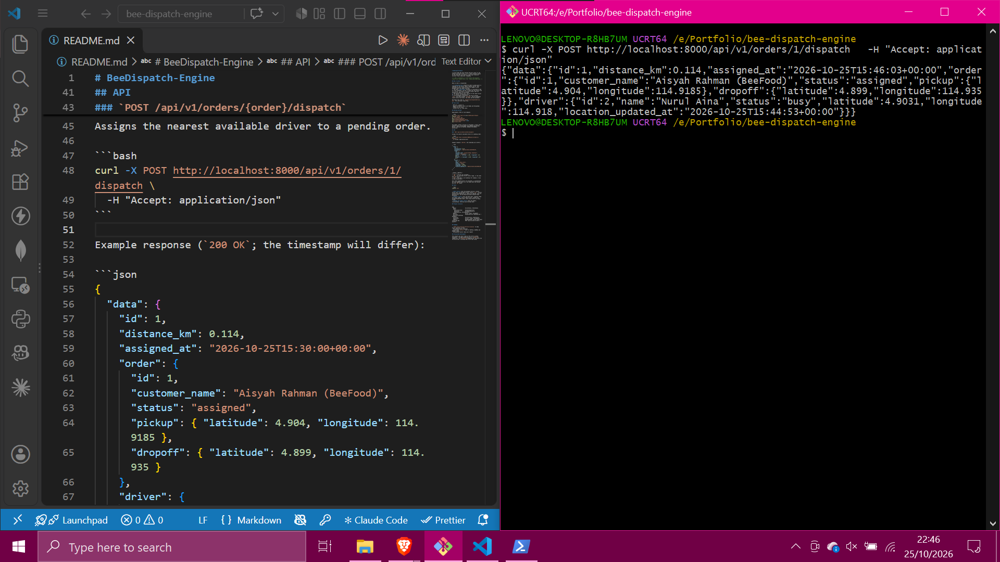

# BeeDispatch-Engine

A Laravel REST API that matches delivery orders to the nearest available driver. It is a small dispatch engine of the kind that sits behind a super app's delivery services (food, medicines, shopping).



## How it works

When an order is dispatched:

1. A **bounding box** around the order's pickup point is computed for the search radius (default 10 km). Only available drivers inside the box are loaded, so the database does the cheap filtering.
2. The exact **Haversine** distance is calculated in PHP for each candidate. The box is square but the search area is a circle, so drivers in the box corners that are outside the radius are discarded.
3. The nearest driver wins. Ties go to the lowest driver id, so results are deterministic.
4. In one database transaction, the driver becomes `busy`, the order becomes `assigned`, and an assignment record stores the driver, the order and the distance.

The whole flow lives in `app/Services/DispatchService.php`. The controller stays thin.

## Tech stack

- PHP 8.3+, Laravel 13
- SQLite by default (works with MySQL and PostgreSQL)
- PHPUnit 12 for tests
- Laravel Pint for code style

## Getting started

Requirements: PHP 8.3+ and Composer.

```bash
git clone <your-repo-url> && cd BeeDispatch-Engine
composer install
cp .env.example .env
php artisan key:generate
touch database/database.sqlite
php artisan migrate:fresh --seed
php artisan serve
```

The seeder creates 5 drivers (3 available, 2 busy) and 5 pending orders around Bandar Seri Begawan and Kiulap, Brunei, labelled as BeeFood, BeeMeds and BeeMall deliveries.

## API

### `POST /api/v1/orders/{order}/dispatch`

Assigns the nearest available driver to a pending order.

```bash
curl -X POST http://localhost:8000/api/v1/orders/1/dispatch \
  -H "Accept: application/json"
```

Example response (`200 OK`; the timestamp will differ):

```json
{
  "data": {
    "id": 1,
    "distance_km": 0.114,
    "assigned_at": "2026-10-25T15:30:00+00:00",
    "order": {
      "id": 1,
      "customer_name": "Aisyah Rahman (BeeFood)",
      "status": "assigned",
      "pickup": { "latitude": 4.904, "longitude": 114.9185 },
      "dropoff": { "latitude": 4.899, "longitude": 114.935 }
    },
    "driver": {
      "id": 2,
      "name": "Nurul Aina",
      "status": "busy",
      "latitude": 4.9031,
      "longitude": 114.918,
      "location_updated_at": "2026-10-25T15:30:00+00:00"
    }
  }
}
```

| Status | Meaning |
| --- | --- |
| `200` | A driver was assigned |
| `404` | No available driver within range, or the order does not exist |
| `409` | The order is not pending (for example, it was already dispatched) |

Only three seeded drivers are available, so dispatching all five seeded orders in a row shows both the success and the `404` paths.

## Tests

```bash
composer test
```

- **Unit tests** cover the dispatch service: closest driver wins, no available drivers returns `null`, drivers outside the bounding box or radius are ignored, ties are deterministic, and the Haversine maths matches known distances.
- **Feature tests** cover the HTTP layer: response shape and status codes, out-of-range drivers, unknown and already-dispatched orders, and a busy driver not being reused.
- **Schema and seeder tests** check the models, relationships, factories and the demo data.

## Project structure

```
app/
  Enums/                 DriverStatus, OrderStatus
  Http/
    Controllers/Api/     DispatchController
    Resources/           AssignmentResource, OrderResource, DriverResource
  Models/                Driver, Order, Assignment
  Services/              DispatchService (bounding box + Haversine matching)
database/
  factories/             DriverFactory, OrderFactory
  migrations/            drivers, orders, assignments
  seeders/               DatabaseSeeder (Brunei demo data)
routes/api.php           POST /api/v1/orders/{order}/dispatch
```

## Roadmap

- `PATCH /api/v1/drivers/{driver}/location` to keep driver positions current
- API authentication (Sanctum)
- A dedicated `service` field for BeeFood, BeeMeds and BeeMall orders
- Configurable search radius per request

## AI-assisted development

This project was built step by step with AI coding assistants. The agent guidelines are in [AGENTS.md](AGENTS.md), and [WORKFLOW.md](WORKFLOW.md) documents how the build went, including what the AI got wrong.
